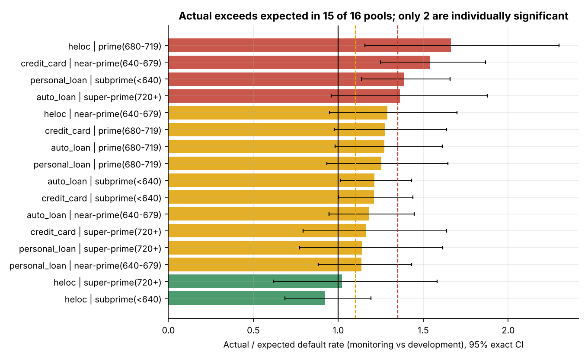
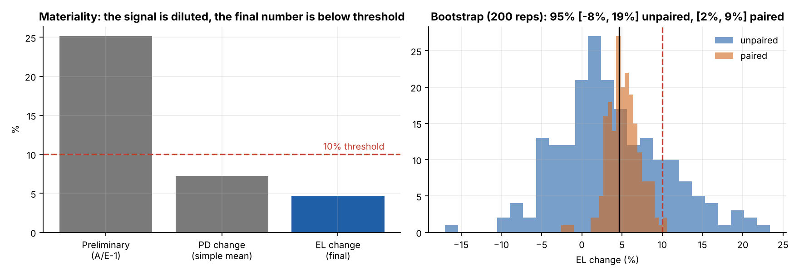

# Category III Bank: Credit-Risk Model Update (PD Recalibration)

**A worked case of a quantitative credit-risk modeler's job from monitoring alert to approved model change**: a fictional Category III U.S. bank, a CECL lifetime-PD model in production, defaults running above expectation. The project shows the data, the analysis, the decision, the validation, the documents that go to governance, and the regulatory reasoning behind each choice.

> Everything here is **synthetic**: no real bank, borrower or portfolio. The fair-lending proxy is synthetic too.
> Author: Cristina Orozco, Quantitative Credit Risk Modeler, Optimum Quants LLC.

## The scenario in one paragraph
A Category III bank holds a $431 million consumer portfolio (credit card, auto, personal loan, HELOC) in 16 pools. Its lifetime-PD model was built on loans originated Jan 2022 to Jun 2023. Twelve months later the monitoring pack shows the default rate up from 7.32% to 9.13%, regional unemployment and house-price inputs in the red band, and actual-to-expected defaults above 1 in 15 of 16 pools. Does the model need a **Model Update**? How big is it? Is it material? Can it be validated? What has to be documented, and why?

## Headline results
| | |
|---|---|
| Diagnosis | Rank ordering intact (AUC 0.704 → 0.704), **levels too low** (mean pool A/E 1.25) → recalibrate, do not redevelop |
| Expected Loss | $19,813,798 → $20,733,968 (**+4.64%**), below the 10% internal threshold |
| Is the change real? | Yes: paired bootstrap 95% interval +1.7% to +8.9% |
| How sure is the *level*? | Much less: unpaired interval -8% to +19%, driven by extrapolated long-dated PDs |
| Holdout (20%, split before fitting) | AUC 0.717, Gini 0.433, KS 0.362, A/E 1.001 |
| **Surprise found by the scope check** | HELOC realized LGD rose 0.30 → 0.36. PD alone +4.6%; with HELOC LGD **+7.4%** (pooled evidence) to **+12.2%** (regime persists): straddles the threshold |



## What makes this more than a recalibration script
* **It reports what the data do not support.** Only 2 of 16 pools are individually significant, and a chi-square test cannot reject a single common shift. So the update pools evidence instead of fitting per-pool adjustments (which would add +20% and chase noise).
* **It separates two bootstraps for two questions:** *is the change real* (paired) and *how sure is the new level* (unpaired).
* **It tests its own scope.** The update was scoped to PD. A scope check found a HELOC LGD break that brings the combined change to between +7.4% and +12.2%, straddling the materiality line, and the report recommends assessing the PD and LGD items together instead of splitting the change.
* **It states the limit of the validation:** out-of-sample, not out-of-time, hence monthly monitoring until the next quarterly cycle.
* **It does not pretend a model settles a forecast.** The pooled estimate (+4.6%) and a full-persistence scalar (+25%) bracket the question; reasonable-and-supportable forecasts under CECL stay with the allowance process.



## Regulatory reasoning
Every decision that rests on a rule, an accounting standard, guidance or an internal judgement is in [`docs/regulatory_decision_log.md`](docs/regulatory_decision_log.md), labelled **[RULE] / [ACCOUNTING] / [GUIDANCE] / [JUDGMENT] / [HISTORICAL]**. Examples: why a Category III bank does not pre-notify this change under the advanced-approaches provisions; why SR 11-7 is treated as superseded by SR 26-2; why the Adverse Impact Ratio is an internal indicator, not a legal test, after the April 2026 Regulation B final rule; why 10% is a judgement and not a rule.

## Repository map (reading order)
| Path | What it is |
|---|---|
| `reports/` | **The deliverables** (PDF + Markdown): Executive Summary, Model Update Report, Model Change Request, Fair Lending Follow-up, Updated Monitoring Plan |
| `notebooks/` | Four executed notebooks: 01 context and data, 02 monitoring trigger, 03 recalibration and impact, 04 validation, scope check and fair lending |
| `docs/` | Regulatory decision log, data decisions log, assumptions and limitations, methodology |
| `case_package/` | What the bank sends to open the engagement: request, model documentation, change policy, monitoring pack |
| `data/raw/` | Initial synthetic extracts (development 20,000 loans, monitoring 10,000), with deliberate data-quality problems |
| `data/processed/` | Cleaned and pool-segmented loan data (flags preserved) |
| `data/production_model/` | The model in production before the update (PD curves, LGD, EAD) |
| `data/DATA_DICTIONARY.md` | Every column |
| `src/mu_catiii.py` | Core methodology (life table, tail hazard, monotonicity, EL, PSI, AUC/KS, AIR) |
| `scripts/` | Five scripts that produce every table, figure and report |
| `outputs/` | Generated tables, figures and the recalibrated PD table (`pd_curves_by_pool_recalibrated.csv`) |

## Reproduce
```bash
pip install -r requirements.txt
python run_all.py            # ~1 minute: tables, figures, reports, notebooks
bash tools/make_pdfs.sh      # optional, needs wkhtmltopdf
```
Seeds are fixed (holdout 7, bootstrap 2026, proxy 999). Numbers in the reports are written from the result tables, never typed by hand.

## Skills this project demonstrates
CECL PD/LGD/EAD modelling (life tables, tail extrapolation, monotonic calibration) · model monitoring (PSI, AUC/Gini/KS, A/E with intervals) · change classification and materiality · statistical honesty (multiple testing, bootstrap design, sampling range of a validation) · fair-lending testing with proxies · model-risk documentation and governance · regulatory mapping for a Category III bank.

## Limits you should know before relying on it
Synthetic data and proxy; one 12-month monitoring regime; out-of-sample validation only; LGD and EAD held at development values in the headline; internal thresholds are judgement; the author is not an independent validator. Full list: [`docs/assumptions_and_limitations.md`](docs/assumptions_and_limitations.md). Not legal or accounting advice.

## License
Code: MIT (see `LICENSE`). Data are synthetic and may be used freely for demonstration.
