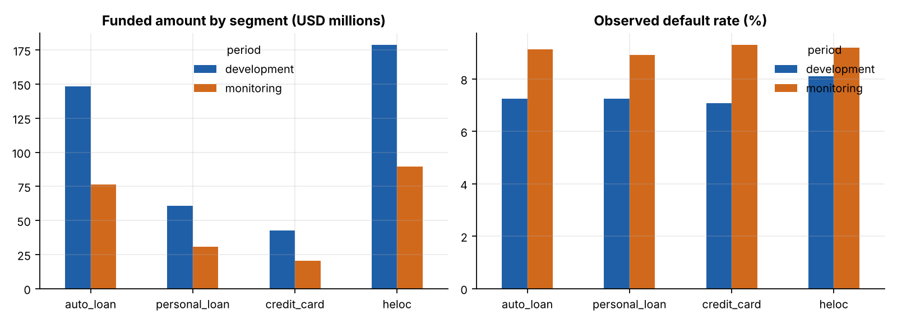
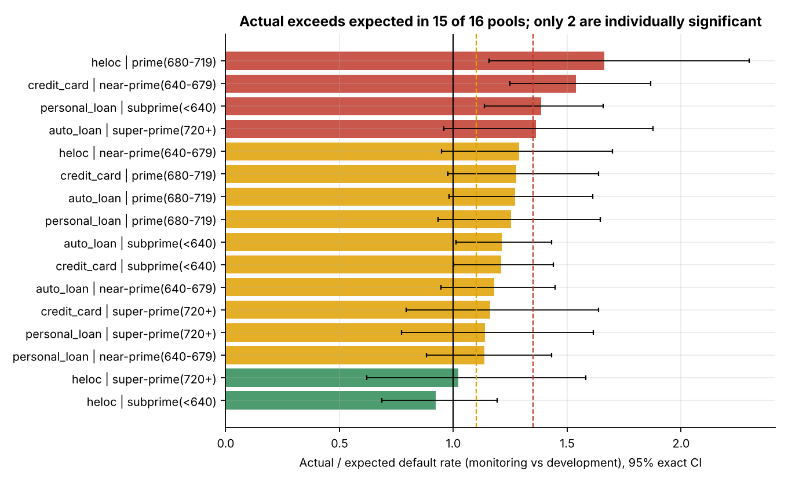
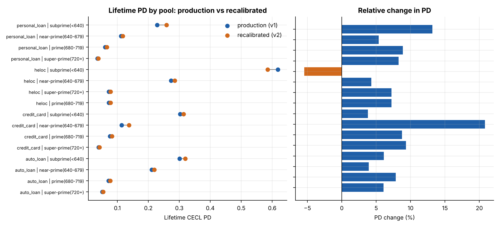
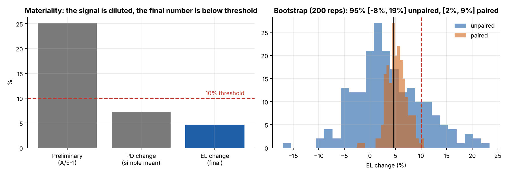
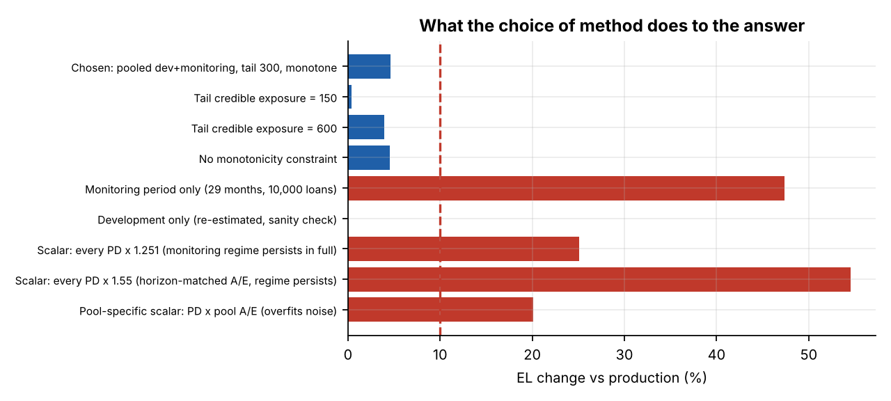

# PD Model Update Report: Category III Bank, Consumer Portfolio
*Prepared by Cristina Orozco, Quantitative Credit Risk Modeler (Optimum Quants LLC). Illustrative case: fictional Category III bank, **synthetic data**. Not a real bank, portfolio or regulatory submission.*

| | |
|---|---|
| Model | Lifetime PD (CECL), 16 pools = 4 products × 4 FICO bands |
| Change type | Recalibration (same methodology, new evidence) |
| Evidence | 30,000 loans: development (Jan 2022 to Jun 2023, 20,000) + monitoring (Jul 2023 to Jun 2024, 10,000) |
| Status | For model governance review |

## 1. Purpose and scope
This report documents the recalibration of the PD component of the bank's CECL model for its consumer portfolio (credit card, auto, personal loan, HELOC), the evidence behind the decision, the validation performed, and the limits of the result. **In scope:** PD. **Out of scope at kickoff:** LGD and EAD, because the monitoring finding concerned default rates. Section 8 tests that boundary and reports a finding that bears on it.

## 2. Background and regulatory context
The bank is treated as a **Category III** banking organization under the 2019 tailoring framework [RULE; library items 13a, 13b]. Consequences that shape this work (details and sources in `docs/regulatory_decision_log.md`):
* Category III banks use the **standardized approach** for risk-weighted assets; the advanced-approaches provisions (12 CFR 3.123 / 217.123) and the related interagency guidance on material changes (BCC 14-2 / GAA 2014-2) apply to advanced-approaches banks. They are **not triggered** here. The change is governed **internally** [JUDGMENT], not by a prior notice to supervisors.
* The model supports the allowance for credit losses under **CECL (ASC 326-20)**: pooling by shared risk characteristics (30-2, 55-5), reasonable and supportable forecasts, and reversion.
* Model risk is managed under the bank's policy, aligned with **SR 26-2** (April 17, 2026, non-binding supervisory guidance, which superseded SR 11-7) [GUIDANCE]. Proportionate documentation, validation and monitoring follow from that policy.
* Fair lending: see section 9.

## 3. Data
Raw extracts were audited before modelling (see `notebooks/01`). Issues found and treated (counts in development / monitoring): invalid FICO 999 (20 / 10); negative DTI (20 / 10); missing income, DTI, refreshed FICO and employment length; utilization not applicable for term loans (kept empty, not zero). Every treatment is flagged in the processed file. `state` and `zip_code` are not model inputs.

## 4. Monitoring findings
Internal thresholds, all [JUDGMENT]: PSI 0.10/0.25; AUC ≥ 0.65 green, 0.60 to 0.65 amber, < 0.60 red; Gini and KS relative drop 10%/20%; A/E 1.10/1.35.

**Stability.**
| Metric                         | Object        |    PSI | Band   |
|:-------------------------------|:--------------|-------:|:-------|
| PSI pool_id (score)            | portfolio     | 0.0015 | GREEN  |
| PSI fico_band                  | auto_loan     | 0.0010 | GREEN  |
| PSI fico_band                  | personal_loan | 0.0013 | GREEN  |
| PSI fico_band                  | credit_card   | 0.0001 | GREEN  |
| PSI fico_band                  | heloc         | 0.0019 | GREEN  |
| PSI unemployment_rate_regional | macro input   | 3.3727 | RED    |
| PSI hpi_change_regional_pct    | macro input   | 1.2808 | RED    |

**Rank ordering.**
| metric   |   Development |   Monitoring | Change   | Band   |
|:---------|--------------:|-------------:|:---------|:-------|
| AUC-ROC  |        0.7039 |       0.7040 | +0.01%   | GREEN  |
| Gini     |        0.4079 |       0.4079 | +0.02%   | GREEN  |
| KS       |        0.3280 |       0.3294 | +0.40%   | GREEN  |

**Levels (actual versus expected).** Mean pool A/E 1.251; 14 of 16 pools above 1.10, 4 above 1.35. Raw rate ratios ignore that monitoring loans are younger (at most 29 months on book against 35). Comparing instead with the **model's own cumulative PD up to each loan's months on book** (horizon-matched A/E) gives a mean pool A/E of **1.55** (1.56 portfolio): the raw 1.25 **understates** the deterioration. (A cruder truncation of development defaults at 29 months gives 1.28; it still mixes loans of different ages and is not used.)

| Pool                                |   n (mon) |   Dev rate |   Mon rate |   A/E |   CI low |   CI high | Band   |
|:------------------------------------|----------:|-----------:|-----------:|------:|---------:|----------:|:-------|
| heloc | prime(680-719)              |       436 |      0.046 |      0.076 | 1.663 |    1.157 |     2.300 | RED    |
| credit_card | near-prime(640-679)   |       652 |      0.087 |      0.133 | 1.538 |    1.248 |     1.867 | RED    |
| personal_loan | subprime(<640)      |       338 |      0.184 |      0.254 | 1.385 |    1.137 |     1.657 | RED    |
| auto_loan | super-prime(720+)       |      1085 |      0.024 |      0.033 | 1.363 |    0.959 |     1.876 | RED    |
| heloc | near-prime(640-679)         |       302 |      0.108 |      0.139 | 1.289 |    0.947 |     1.699 | AMBER  |
| credit_card | prime(680-719)        |       810 |      0.055 |      0.070 | 1.277 |    0.975 |     1.637 | AMBER  |
| auto_loan | prime(680-719)          |       871 |      0.056 |      0.071 | 1.270 |    0.982 |     1.612 | AMBER  |
| personal_loan | prime(680-719)      |       726 |      0.053 |      0.066 | 1.254 |    0.932 |     1.644 | AMBER  |
| auto_loan | subprime(<640)          |       421 |      0.200 |      0.242 | 1.211 |    1.011 |     1.431 | AMBER  |
| credit_card | subprime(<640)        |       403 |      0.195 |      0.236 | 1.210 |    1.001 |     1.438 | AMBER  |
| auto_loan | near-prime(640-679)     |       693 |      0.098 |      0.115 | 1.180 |    0.946 |     1.447 | AMBER  |
| credit_card | super-prime(720+)     |      1041 |      0.026 |      0.030 | 1.161 |    0.792 |     1.637 | AMBER  |
| personal_loan | super-prime(720+)   |       935 |      0.028 |      0.032 | 1.138 |    0.772 |     1.614 | AMBER  |
| personal_loan | near-prime(640-679) |       536 |      0.102 |      0.116 | 1.136 |    0.882 |     1.432 | AMBER  |
| heloc | super-prime(720+)           |       550 |      0.034 |      0.035 | 1.022 |    0.619 |     1.581 | GREEN  |
| heloc | subprime(<640)              |       201 |      0.232 |      0.214 | 0.921 |    0.686 |     1.193 | GREEN  |

**Reading it honestly.** Only 2 pools are individually significant after Bonferroni correction, and a chi-square test does not reject a single common shift across all pools (χ² = 14.0, 15 df, p = 0.52). The spread of pool A/E (0.92 to 1.66) is consistent with sampling noise. This is why the update does not fit pool-specific adjustments.

**Diagnosis.** Ranking intact, levels low, macro inputs red: **recalibrate**. No evidence of a structural break in the pool mix (PSI of the pool distribution 0.0015).

## 5. Classification of the change
* **By scope:** minor. Pure recalibration: no change to the default definition, segmentation or technique [JUDGMENT].
* **By magnitude:** preliminary signal 25.1% (mean A/E − 1) would have exceeded the 10% internal threshold. The final, properly sized figure on Expected Loss is **+4.64%**, below it. The preliminary figure overstated the impact because pooling the monitoring period with the stable history dilutes it (the simple mean of pool PD changes is 7.23%; the EL-weighted change is 4.64%).
* **Combined with the HELOC LGD finding (section 8):** +7.4% if HELOC LGD is re-estimated on pooled evidence (the same logic as the PD), +12.2% if the monitoring-period LGD persists. The range straddles the threshold. **Recommendation:** assess the PD and LGD items **together** (the PD-only figure is under the threshold only because of where the scope boundary was drawn), apply the policy's borderline rule (sensitivity shown in section 8), and treat the package as potentially material for internal governance until the HELOC LGD review settles which reading applies. [JUDGMENT, for the governance committee to decide]

## 6. Method
Unchanged from production: 3-month life-table hazards by pool; a tail hazard from the pooled last buckets until at least 300 loans of exposure [JUDGMENT]; isotonic regression across FICO bands within each segment so that a better band never carries a higher PD; EL = PD × LGD × EAD$ × loans with LGD and EAD unchanged. Only the evidence changes. Code: `src/mu_catiii.py`. Sanity check: re-estimating on development data alone reproduces the production PDs (EL change 0.00%).

## 7. Results
**Expected Loss.** $19,813,798 (4.60%) → $20,733,968 (4.81%) of $430,631,113 funded; change $920,170 (**+4.64%**).

| Segment       | EL production   | EL recalibrated   | Change   |
|:--------------|:----------------|:------------------|:---------|
| auto_loan     | $6,272,843      | $6,624,022        | +5.60%   |
| credit_card   | $2,988,028      | $3,278,647        | +9.73%   |
| heloc         | $7,692,665      | $7,704,239        | +0.15%   |
| personal_loan | $2,860,263      | $3,127,061        | +9.33%   |

| Pool                                |   PD v1 |   PD v2 | Change   |
|:------------------------------------|--------:|--------:|:---------|
| auto_loan | subprime(<640)          |  0.3012 |  0.3196 | +6.1%    |
| auto_loan | near-prime(640-679)     |  0.2112 |  0.2195 | +3.9%    |
| auto_loan | prime(680-719)          |  0.0715 |  0.0771 | +7.9%    |
| auto_loan | super-prime(720+)       |  0.0512 |  0.0543 | +6.1%    |
| credit_card | subprime(<640)        |  0.3023 |  0.3137 | +3.8%    |
| credit_card | near-prime(640-679)   |  0.1136 |  0.1373 | +20.8%   |
| credit_card | prime(680-719)        |  0.0759 |  0.0825 | +8.8%    |
| credit_card | super-prime(720+)     |  0.0390 |  0.0426 | +9.3%    |
| heloc | subprime(<640)              |  0.6186 |  0.5849 | -5.4%    |
| heloc | near-prime(640-679)         |  0.2736 |  0.2853 | +4.3%    |
| heloc | prime(680-719)              |  0.0723 |  0.0775 | +7.2%    |
| heloc | super-prime(720+)           |  0.0723 |  0.0775 | +7.2%    |
| personal_loan | subprime(<640)      |  0.2287 |  0.2588 | +13.2%   |
| personal_loan | near-prime(640-679) |  0.1115 |  0.1174 | +5.4%    |
| personal_loan | prime(680-719)      |  0.0605 |  0.0659 | +8.9%    |
| personal_loan | super-prime(720+)   |  0.0357 |  0.0387 | +8.3%    |

HELOC prime and super-prime end at the same PD: the unconstrained estimates were reversed (prime below super-prime) and the monotonicity step pools them, as in production. HELOC subprime falls (-5.4%), consistent with its A/E below 1.

**Out-of-sample validation.** 20% of the pooled loans (6,000), stratified by pool, were set aside before fitting. Holdout AUC 0.7165, Gini 0.4331, KS 0.3623; aggregate raw-rate A/E 1.0013 (sampling range 0.92 to 1.08). *This is out-of-sample, not out-of-time*: it shows the fit is not memorising rows, not that the model will hold under conditions that have not occurred.

**Uncertainty.** Two bootstraps answer two questions.
* *Is the change real?* Paired bootstrap: 95% interval 1.7% to 8.9%; 1% of resamples above 10%. Yes, and below the threshold.
* *How sure is the new level?* Unpaired bootstrap: 95% interval -8% to 19%; 18% of resamples above 10% (largest contributors: HELOC and auto, where lifetime PD is mostly extrapolated).

**Method sensitivity.**
| Alternative                                                    | EL change   | > 10%?   |
|:---------------------------------------------------------------|:------------|:---------|
| Chosen: pooled dev+monitoring, tail 300, monotone              | +4.64%      | no       |
| Tail credible exposure = 150                                   | +0.35%      | no       |
| Tail credible exposure = 600                                   | +3.96%      | no       |
| No monotonicity constraint                                     | +4.53%      | no       |
| Monitoring period only (29 months, 10,000 loans)               | +47.36%     | yes      |
| Development only (re-estimated, sanity check)                  | +0.00%      | no       |
| Scalar: every PD x 1.251 (monitoring regime persists in full)  | +25.12%     | yes      |
| Scalar: every PD x 1.55 (horizon-matched A/E, regime persists) | +54.57%     | yes      |
| Pool-specific scalar: PD x pool A/E (overfits noise)           | +20.07%     | yes      |

The pooled estimate and the scalar mark two ends of one question: does the monitoring-period environment persist? That is a forecast judgement, outside the model. The recalibrated PD is a better *base*; the allowance process still owns the forecast and reversion assumptions.

## 8. Scope check: LGD and EAD
Realized LGD (1 − recovery ÷ EAD on defaulted loans) and realized EAD measures were compared between periods.
| Segment       |   Defaults dev |   Defaults mon |   LGD in model |   Realized dev |   Realized mon |    Diff |   p-value |
|:--------------|---------------:|---------------:|---------------:|---------------:|---------------:|--------:|----------:|
| auto_loan     |            432 |            280 |         0.4250 |         0.4247 |         0.4330 |  0.0082 |    0.3881 |
| personal_loan |            366 |            226 |         0.8195 |         0.7922 |         0.7971 |  0.0048 |    0.6185 |
| credit_card   |            423 |            270 |         0.8970 |         0.8717 |         0.8643 | -0.0074 |    0.3647 |
| heloc         |            243 |            137 |         0.2865 |         0.2994 |         0.3576 |  0.0582 |    0.0000 |

HELOC realized LGD rose by 0.058 (p < 0.0001); the other products did not move. House-price growth fell from about +4.0% to +1.0% over the same window, the expected collateral channel. By vintage the move is a break at the 2023H2 originations. Caveat: monitoring loans have had less time to recover, which could bias LGD upward, but the same shorter window did not move the other three products. EAD measures show no change that survives correction for eight tests (personal-loan EAD ratio, p = 0.014, is the closest).

| Scenario                                                 | EL          | Change vs production   | > 10%?   |
|:---------------------------------------------------------|:------------|:-----------------------|:---------|
| PD recalibration only (the Model Update scope)           | $20,733,968 | +4.64%                 | no       |
| HELOC LGD only, pooled evidence                          | $20,353,258 | +2.72%                 | no       |
| PD recalibration + HELOC LGD, pooled evidence            | $21,274,239 | +7.37%                 | no       |
| HELOC LGD only, monitoring regime persists               | $21,310,109 | +7.55%                 | no       |
| PD recalibration + HELOC LGD, monitoring regime persists | $22,232,530 | +12.21%                | yes      |

The two readings bracket the same forecast question as for PD: do the monitoring conditions persist? Splitting a change to stay under a materiality line defeats the purpose of the line, so the recommendation in section 5 is to assess the package jointly. The PD update is delivered as scoped; a HELOC LGD review is opened as a **linked** item.

## 9. Fair lending
A synthetic BISG-style proxy (never a model input) was used to compute an Adverse Impact Ratio with approval defined as lifetime PD at or below the portfolio median. Internal scale [JUDGMENT]: ≥ 0.90 green, 0.80 to 0.90 amber, < 0.80 red.
| Scope         |   AIR production |   AIR recalibrated | Band (prod.)   | Band (recal.)   |   AIR prod., product cut-off |   AIR recal., product cut-off |
|:--------------|-----------------:|-------------------:|:---------------|:----------------|-----------------------------:|------------------------------:|
| all           |           0.8138 |             0.8138 | AMBER          | AMBER           |                       0.8387 |                        0.8387 |
| auto_loan     |           0.8360 |             0.8360 | AMBER          | AMBER           |                       0.8360 |                        0.8360 |
| personal_loan |           0.8376 |             0.8376 | AMBER          | AMBER           |                       0.8376 |                        0.8376 |
| credit_card   |           0.7342 |             0.7342 | RED            | RED             |                       0.8479 |                        0.8479 |
| heloc         |           0.8284 |             0.8284 | AMBER          | AMBER           |                       0.8284 |                        0.8284 |

The recalibration leaves AIR unchanged at this precision (levels shift, the order of loans around the median does not). The product-level credit-card result (0.73, red) is **a methodological artifact, not a finding**: with one portfolio-wide median cut-off only 36% of cards fall under the cut-off (against about 65% for the other products), because cards carry higher PDs. With a cut-off set inside each product the card AIR is 0.85, in line with the other products. Regulatory framing: the CFPB final rule of April 22, 2026 (91 FR 21620, effective July 21, 2026) states that ECOA does not provide a disparate-impact (effects) test; proxy-based **disparate treatment** remains prohibited; for HELOC the Fair Housing Act is still read to cover disparate impact (*Inclusive Communities*, 2015). AIR is therefore used as an internal governance indicator, not as a legal test.

## 10. Limitations
See `docs/assumptions_and_limitations.md`. The ones that matter most: synthetic data and a synthetic proxy; one monitoring period (12 months, one regime); out-of-sample, not out-of-time validation; long-dated PDs rest on a tail extrapolation; LGD and EAD are held at development values; internal thresholds are judgement.

## 11. Conditions and recommendations
1. Approve the PD recalibration (v2 table in `outputs/pd_curves_by_pool_recalibrated.csv`).
2. Open a **HELOC LGD review**, linked to this change; assess the package jointly (range +7.4% to +12.2%, straddling the threshold).
3. **Monthly** monitoring until the next quarterly cycle: PSI (macro), A/E by pool, HELOC realized LGD.
4. Allowance process to document the forecast and reversion view in light of the macro PSI red and the range in section 7.
5. Ask Compliance for a real proxy and to confirm how the PDs are used downstream; the product-level AIR should use product-level cut-offs.
6. Independent validation of the recalibration before the next allowance cycle.
